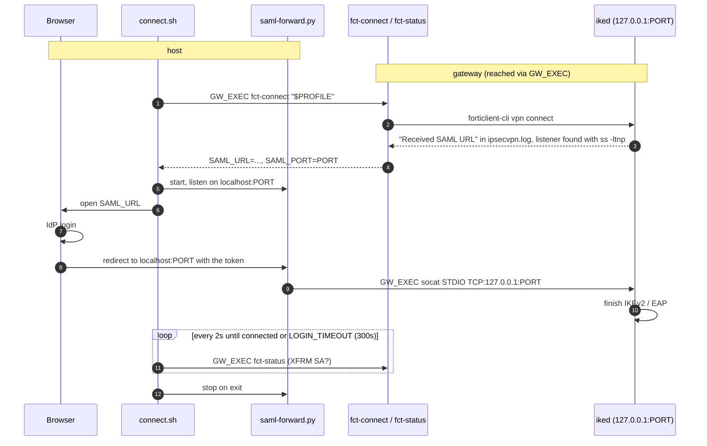

# forticlient-vpn-headless

Run the vendor FortiClient VPN (IPsec IKEv2 + SAML) headless in a Docker
container or a small VM. Do the SAML login in the host's browser, and use the
tunnel from the host through a SOCKS5 proxy. DNS and `/etc/hosts` changes stay
inside the gateway.

See [docs/PLAN.md](docs/PLAN.md) for the design and
[docs/FINDINGS.md](docs/FINDINGS.md) for what was learned about FortiClient
internals.

## Setup

```bash
cp /path/to/your-profile.xml secrets/   # git-ignored
cp .env.example .env                    # git-ignored; set FCT_PROFILE (and GW/SSH_OPTS for a VM)
```

The Docker build uses `vendor/forticlient_vpn_<version>_<arch>.deb` when it
is there, and otherwise downloads it from Fortinet and checks its SHA-256:

```bash
# Optional: use local debs (no download on every rebuild).
cp ~/Downloads/forticlient_vpn/forticlient_vpn_7.4.3.5411_{arm64,amd64}.deb vendor/
```

Build arguments: `FCT_VERSION` (default `7.4.3.5411`), `FCT_URL` (default
`https://filestore.fortinet.com/forticlient/downloads/forticlient_vpn_${FCT_VERSION}_${TARGETARCH}.deb`)
and `FCT_SHA256_amd64` / `FCT_SHA256_arm64` (pinned for the default version;
set to empty to skip the check for another version). The Lima and external VM
installers still need the deb in `vendor/`.

The image is not published to a registry: Fortinet's EULA (§2) does not
allow redistributing FortiClient, so everyone builds their own and gets the
deb from Fortinet directly.

## Docker

```bash
make docker-up          # build, start, import secrets/*.xml, SOCKS5 on 127.0.0.1:1080
make docker-connect     # opens SAML login in your browser, waits for the tunnel
make docker-status
curl --socks5-hostname 127.0.0.1:1080 http://some.internal.host/
```

Change the profile name with `make docker-connect PROFILE="Other VPN"`.
To import a profile into the running container without restarting it:
`docker exec -i fct-headless fct-import /dev/stdin < your-profile.xml`.

### Shut down

```bash
make docker-disconnect  # close the tunnel; DNS and routes inside the container are restored
make docker-status      # should print STATE=disconnected
make docker-down        # stop and remove the container, its network and the image
```

`make docker-disconnect` keeps the container running, so you can run
`make docker-connect` again. `make docker-down` removes everything. The next
`make docker-up` rebuilds from scratch. If the container is gone, nothing on
the host needs cleaning up: the VPN never touched the host's DNS or routes.

The container needs `NET_ADMIN`, `SYS_PTRACE` and `SYS_ADMIN`, plus
`seccomp=unconfined` (FortiClient uses the kernel keyring). It also needs a
network subnet that the VPN does not push (`FCT_SUBNET`, default
`198.18.0.0/24`). [docs/FINDINGS.md](docs/FINDINGS.md) explains why.

## Lima VM

A local, ephemeral Debian 13 VM (arm64, `vz`, 1 CPU, 768 MiB, ~0.8 GB disk
used) on macOS, created from `lima/forticlient-vpn-headless.yaml`. The repo
is mounted read-only and `scripts/install-gateway.sh` runs on first boot. SOCKS5 is forwarded to
`127.0.0.1:1080`.

```bash
make vm-up              # create (or recreate) the VM and install the gateway
make vm-connect         # opens SAML login in your browser, waits for the tunnel
make vm-status
make vm-disconnect      # close the tunnel, keep the VM
make vm-down            # delete the VM
```

## External VM gateway

Any Debian/Ubuntu VM you can reach over SSH, for example on a hypervisor in
your LAN. Tested on Debian 13 (amd64). Copy the needed
parts of the repo to the VM, then run the installer there. It is safe to re-run.

```bash
GW=root@<gateway-ip>; KEY=~/.ssh/<key>
COPYFILE_DISABLE=1 tar --no-xattrs -czf - scripts secrets/*.xml vendor/*_amd64.deb \
  | ssh -i $KEY $GW 'mkdir -p /opt/fct-headless && tar -xzf - -C /opt/fct-headless --no-same-owner'
ssh -i $KEY $GW bash /opt/fct-headless/scripts/install-gateway.sh /opt/fct-headless
```

Then, from your machine:

```bash
make ssh-connect      # GW and SSH_OPTS from .env (or pass GW=... SSH_OPTS=...)
make ssh-status
make ssh-disconnect
```

Point SOCKS5 at `<vm>:1080`. The installer adds `fct-microsocks.service`
unless something already listens on 1080. It also installs an empty
`forticlient-headless-deps` package that stands in for the GUI libraries, so
apt stays consistent.

If the VPN pushes the gateway's own LAN (for example `192.168.1.0/24`),
`fct-protect-lan` keeps it local. It adds a policy rule per directly attached
subnet (table and priority 201), which takes precedence over the main table
where FortiClient puts its routes. The subnets are detected automatically.
`fct-connect` applies the rules before every connect, so a recreated VM needs
nothing else. Corporate hosts in that range are then unreachable through this
gateway.

## How it works

| Piece | Where | What |
|-------|-------|------|
| `fct-start` | gateway | starts `fctsched` (or the systemd unit) |
| `fct-import` | gateway | GUI-equivalent XML restore through `confighandler` |
| `fct-connect` | gateway | starts the connect, prints `SAML_URL` and `SAML_PORT` |
| `fct-status` / `fct-disconnect` | gateway | tunnel state (XFRM SA) / stop |
| `scripts/connect.sh` | host | opens the URL, forwards the callback port, waits |
| `scripts/saml-forward.py` | host | `localhost:PORT` → `GW_EXEC socat` → gateway `127.0.0.1:PORT` |

### The SAML callback

With a normal desktop FortiClient, a SAML login works like this. FortiClient
starts the IPsec connection, gets a login URL from the VPN server and opens
it in your browser. You log in with your identity provider, and the browser
is then redirected to `http://localhost:<port>/…`. FortiClient's `iked` is
listening on that port, picks up the login token from the request and
finishes the connection. The port is random and changes on every attempt.

Here, FortiClient runs somewhere else (a container, the Lima VM or a remote
VM), but the browser runs on your machine. When the browser follows that
redirect to `localhost:<port>`, it reaches your own machine, where nothing
is listening. So the redirect has to be carried over to the gateway:

1. `fct-connect` starts the connection on the gateway. It reads the login
   URL from FortiClient's log and finds the port `iked` is listening on.
2. `connect.sh` opens the URL in your browser. It also starts
   `saml-forward.py`, which listens on the same port on your machine.
3. When the redirect arrives, `saml-forward.py` runs `socat` on the gateway
   (through `docker exec`, `limactl shell` or `ssh`) and connects to `iked`'s
   port there. It passes the HTTP request through and sends `iked`'s reply
   back to the browser.
4. `iked` gets the token and brings up the tunnel. `connect.sh` checks
   `fct-status` until the tunnel is up, then stops the forwarder.

No port needs to be published on the gateway for this. The request goes
through the same command channel used to run the other commands there
(`GW_EXEC`). This is why the same `connect.sh` works for `make
docker-connect`, `make vm-connect` and `make ssh-connect`. A fixed
`docker -p` or Lima port forward could not do it, because the port changes
every time.



- `saml-forward.py` connects through only after the browser sends data.
  Browsers pre-open idle sockets, and `iked`'s callback server handles one
  connection at a time, so an idle socket would block the real request.
- Running `connect` again is safe. If an attempt is already waiting for SAML,
  `fct-connect` reuses its URL. If the tunnel is up, it prints
  `STATE=connected`.
